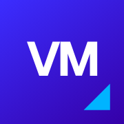
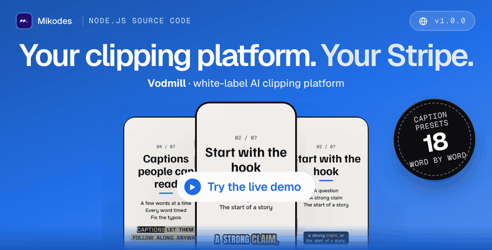
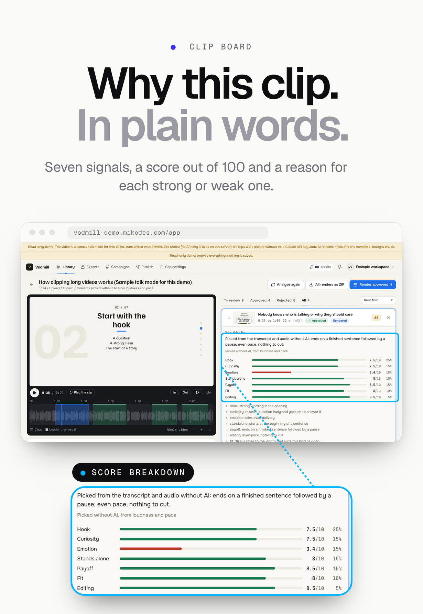
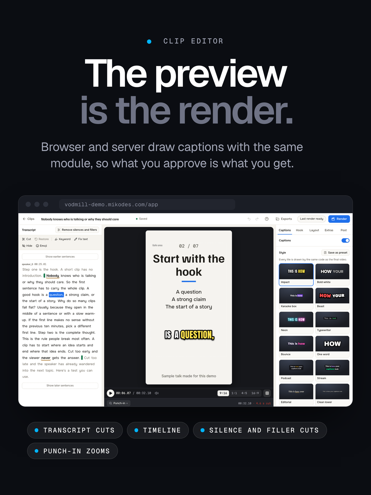
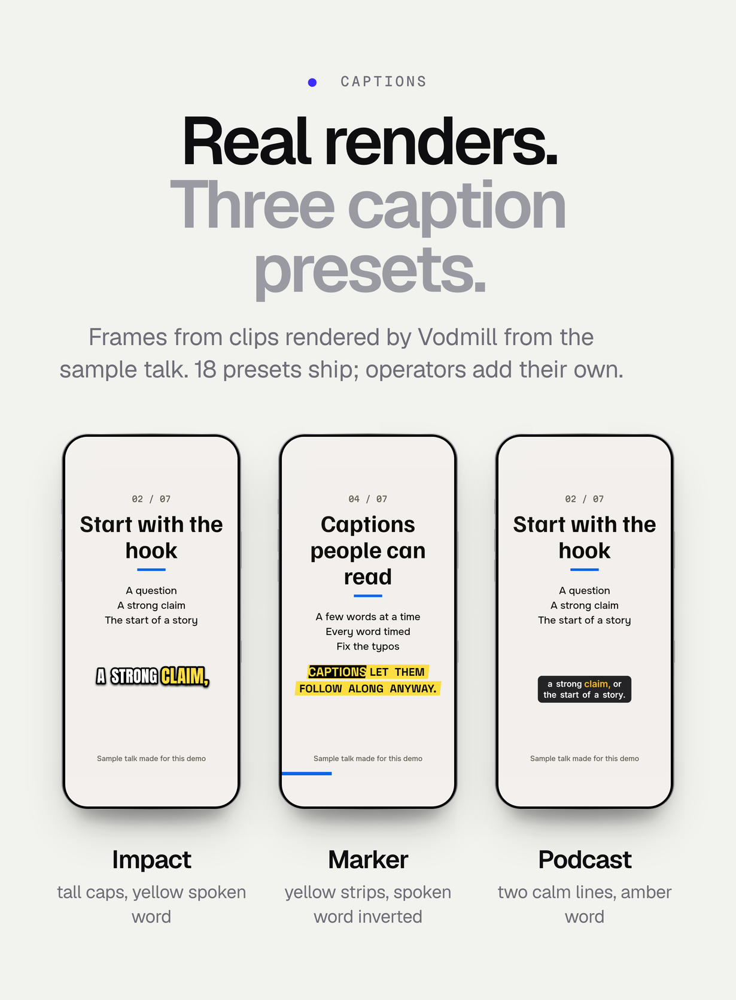
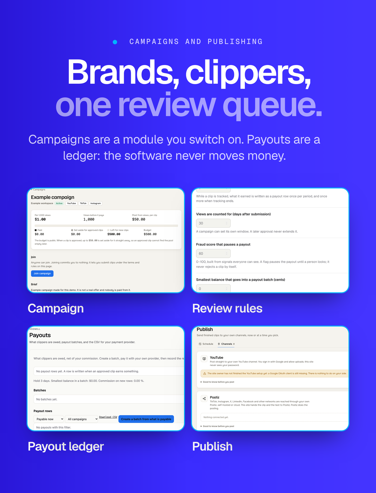
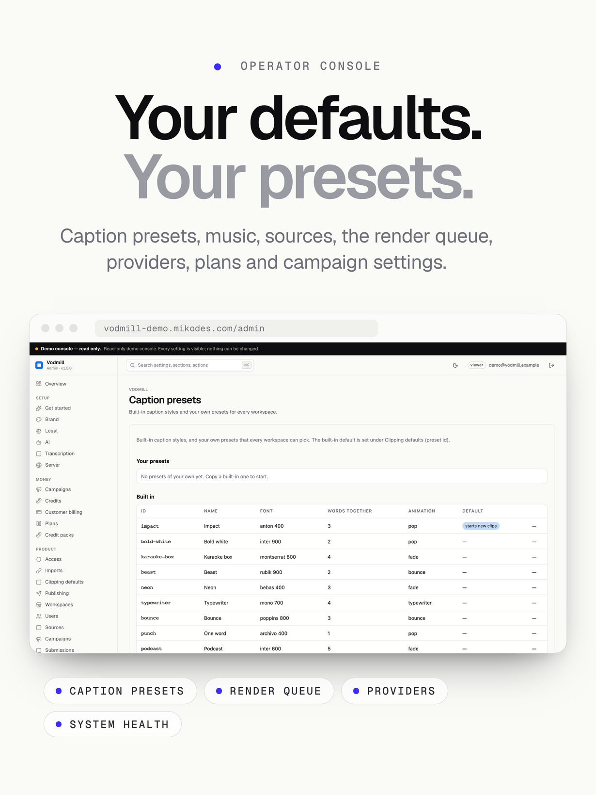

  

<h1 align="center">Vodmill</h1>

  <b>AI video clipping platform with paid clipping campaigns.</b>

AI clipping tool source code · long videos to Shorts, Reels & TikToks · clipping campaigns · white-label SaaS

  <a href="https://vodmill-demo.mikodes.com/"><b>▶ Live demo</b></a> ·
  <a href="https://vodmill.mikodes.com/docs/"><b>Docs</b></a> ·
  <a href="https://vodmill.mikodes.com/"><b>Website</b></a> ·
  <a href="https://store.mikodes.com/p/vodmill/"><b>Get the full source code</b></a>

  
  
  
  

  

> **This repository is a showcase.** It holds screenshots, documentation pointers and a real excerpt
> from the code. The full application is sold as source code at
> **[store.mikodes.com/p/vodmill](https://store.mikodes.com/p/vodmill/)**: one payment, instant ZIP download, free setup help.

---

## What it is

Long videos and streams become scored, face-tracked, word-captioned vertical clips on your own server, and brands run paid clipping campaigns with a review queue and a payout ledger.

## Screens

 

 

## Features

- **Sources: resumable upload, library, 720p proxy, waveform and thumbnails**: Long videos and stream recordings go in once and stay in a workspace library.
- **Score from 7 named signals with a reason each**: hook 25, curiosity 15, emotion 15, standalone 15, payoff 15, editing 5, fit 10: a score a user can read, not a magic number.
- **Complete-thought check with one-click fix**: Flags clips that start mid-thought or end before the payoff and offers corrected boundaries.
- **Face-tracked reframing**: 9:16 crops follow the person who talks, per shot, with a steady dead zone.
- **18 word-by-word caption presets drawn by one canvas module for browser preview and server render**: The editor preview is the render.
- **Render: one ffmpeg pass per clip and aspect**: Finished vertical clips plus subtitle files and an edit list for an NLE.
- **Clip board, exports and public share page**: Approve/reject suggested clips, download or share finished ones.
- **Campaigns: budget, rate per 1,000 views, min views, per-clip cap, rules, open/invite/application access**: The operator runs a content-rewards programme: brands post campaigns, clippers join and submit links.
- **Submission review queue, fraud score with visible signals, one appeal**: A flag pauses a payout, never rejects by itself.
- **Payout ledger: reservations against budget, hold period, batches, CSV, mark-paid with reference, commission…**: Records what each clipper is owed and what was recorded as paid.
- **Workspaces, team roles, invites, onboarding, notifications**: Agencies keep each client or creator in its own workspace.
- **Credits, plans and Stripe**: The operator prices each action.

## How it works

A technical case study of the architecture, one end-to-end flow, the key engineering decisions and how you would build something like this: **[docs/HOW-IT-WORKS.md](docs/HOW-IT-WORKS.md)**.

## A look at the code

Real excerpts from the source, shown for illustration:

- **Explainable clip fraud score** ([`snippets/fraud.ts`](snippets/fraud.ts)): Views-for-pay campaigns attract fake views, so each clip gets a 0-100 score built from named signals such as a single jump in views or almost no engagement. Every signal shows its numbers, and a high score only holds the payout for a person to review.
- **Payout math in integer cents** ([`snippets/payout_math.ts`](snippets/payout_math.ts)): Per-view pay, a per-clip cap, a budget reservation and a capped operator commission are all integer arithmetic. The invariant is that reserved plus paid never exceeds the campaign budget, and a payout row is a ledger entry, not a money transfer.
- **One post, one submission** ([`snippets/post_url_parser.ts`](snippets/post_url_parser.ts)): A pasted link is reduced to a platform and a stable post id, ignoring tracking parameters and host variants, so the same clip cannot be submitted twice. Refusals are sentences a clipper can act on.

## Requirements (full version)

- Node.js 22.12 or newer
- ffmpeg and ffprobe on the server
- A VPS
- Domain + https reverse proxy
- ADMIN_SECRET_KEY
- Transcription: one of ElevenLabs API key, a Whisper-compatible API key

Not included: Hosting, VPS and domain; No API keys: Anthropic, ElevenLabs, Whisper-compatible provider, Stripe, Resend, Google/YouTube and Twitch usage is billed to the buyer's…; yt-dlp is not bundled; ffmpeg and whisper.cpp are not bundled; No direct posting to TikTok or Instagram.

## FAQ

**Is this the full source code?**  
No. This repository is a showcase with screenshots, a technical case study and real code excerpts. The complete Vodmill source code is sold at [store.mikodes.com/p/vodmill](https://store.mikodes.com/p/vodmill/).

**What is Vodmill built with?**  
Hono, Node.js, React, ffmpeg.

**Can I try it before buying?**  
Yes, open the [live demo](https://vodmill-demo.mikodes.com/).

**Do I get help with the installation?**  
Free setup help is included with the store purchase; questions go to [mikodes.com/support](https://mikodes.com/support).

## Get the full source code

  

One payment, full licence, instant ZIP download and free setup help.
Questions: [mikodes.com/support](https://mikodes.com/support).

---

  Made by <a href="https://mikodes.com"><b>MIKODES</b></a> · <a href="https://github.com/Mikodesteam">more projects</a>

