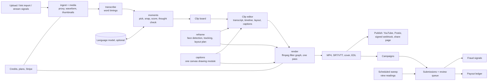

# How Vodmill works

An engineering write-up of Vodmill, a platform that turns long videos and streams into short, captioned, vertical clips, and can run "views-for-pay" campaigns around them. It describes what the code does and why. The full source is sold separately (link at the end); only a few excerpts are public.

## Reading order

If you only have five minutes, read "Key engineering decisions", then the three excerpts in [`../snippets/`](../snippets/): [`fraud.ts`](../snippets/fraud.ts), [`payout_math.ts`](../snippets/payout_math.ts) and [`post_url_parser.ts`](../snippets/post_url_parser.ts). None is a working module on its own.

## The problem and who it is for

Cutting a good 30-second clip from an hour of talking means finding the moment, starting and ending on sentence boundaries, keeping the speaker in frame in a vertical crop, and adding captions that look right. Doing that by hand does not scale. Vodmill automates the steps and leaves a person in control of the result: a clip editor with a transcript, a timeline and a render dialog.

The second half is a campaign system: a brand sets a budget and a rate per thousand views, clippers post clips and submit links, views are tracked, and a ledger records what each clipper is owed. It is for agencies and creators who clip content, and for operators who want to run their own clipping service with accounts, plans and credits.

## Architecture

A TypeScript monorepo of small packages with one server and one web app. The packages mirror the pipeline stages; the server wires them to a database, a job queue, billing and an operator console.

Main packages: `ingest` and `media` (sources, ffmpeg wrappers), `transcribe` (several speech-to-text backends), `moments` (clip selection), `reframe` (face-aware cropping), `captions` (styles and drawing), `render` (the filter graph and the render run). The server holds the campaigns module, publishing, credits and the API.

## One flow, step by step: a long video becomes captioned clips

1. **Source.** The user uploads a file (resumable), or imports a link through the operator's own downloader if the operator turned that on. The server stores the file and makes a 720p proxy, a waveform and thumbnails.
2. **Gate and charge.** Before analysis starts the server checks the plan (maximum source length, minutes per month), estimates the cost, and in one transaction re-checks that the source is not already queued before debiting credits. A failure later refunds the charge.
3. **Transcribe.** Speech to text produces words with timings. Three backends are supported (a hosted service, any Whisper-compatible HTTP endpoint, or a local engine), so the operator chooses cost and privacy.
4. **Propose moments.** With a language model, the annotated transcript is read and clips are proposed as ranges of sentences, with signal scores, reasons and copy. Without a model (or if it fails) a heuristic picker answers, and every moment says which of the two it came from. Stream sources can also contribute chat spikes and viewer clips as signals.
5. **Snap.** Code, not the model, decides the cut. A start moves to a real sentence start (not a conjunction, greeting or filler), an end moves to a real sentence end, a sentence longer than the limit is cut at a clause boundary, and length limits are respected. Every adjustment is recorded in a "moved" list for debugging and tests.
6. **Ground the copy.** Hooks and titles are checked against the transcript so a title cannot claim something nobody said.
7. **Score.** Seven named signals are computed from the text, audio and chat with no model, each with a short reason; the model's own signals are fused with them so no number rests on a single opinion. The result is a 0 to 100 score where the weights sum to 100.
8. **Complete-thought check.** A second pass proves what code can prove (starts inside a sentence, opens with a greeting, breaks the limits) and asks a model to flag what only a reader can see (a missing set-up, an answer after the cut). Each flag carries a one-click fix: a new start or end on a sentence boundary.
9. **Reframe.** Faces are detected on sampled frames, tracked, and turned into a crop plan with a dead zone (the crop only follows when a face moves far enough), smoothing, speaker choice by mouth movement, and layouts such as fill, fit, split, stack and screen. The plan is data; the renderer turns it into filters.
10. **Edit.** The user can edit the transcript, the timeline, the layout and the caption style. Automatic cuts for silences, filler sounds and false starts return source-time ranges the user can accept.
11. **Render.** One ffmpeg pass per clip and aspect ratio builds the video and audio from a single filter graph, with captions drawn as an overlay.
12. **Deliver.** MP4, subtitles, a cover and an edit list; a public share page, a scheduled upload to a video platform, or a signed webhook.

## Key engineering decisions

### 1. The model proposes, code decides

*Chosen:* the language model proposes sentence ranges and copy; code validates its JSON (repairing it once), snaps every range to clean boundaries, grounds the hooks, removes overlaps, spreads the picks across the video and runs the thought check. *Alternative:* trust the model's timestamps. *Why:* models are good at "this part is interesting" and unreliable at exact cut points. Snapping on sentence boundaries is deterministic and testable, and it makes the heuristic fallback produce clips of the same shape.

### 2. A score made of named signals with reasons

*Chosen:* seven named signals, each 0 to 10, each with a one-line reason, weighted to 100; model signals are fused with computed ones. *Alternative:* one opaque "virality" number. *Why:* a user can see why a clip scored high and disagree with it, and the same engine scores the no-key heuristic picks. Genre changes the sweet-spot clip length (for example a vlog or stream clip is shorter than a podcast clip).

### 3. The preview is the render

*Chosen:* all caption and overlay drawing is a pure function of the clip spec, the words, the plan, the size and the time, using only a canvas interface. The browser editor imports the same file for live preview that the server uses for rendering. *Alternative:* a separate preview implementation. *Why:* when the preview and the render disagree users lose trust. One drawing module means a caption style cannot look different in the editor.

### 4. A reframer whose planning step is pure

*Chosen:* detection (a small face-detection model run through an ONNX runtime, with input and output names and shapes checked when the session loads) is separate from planning, which takes detections and returns a plan and is tested on recorded detections. *Alternative:* detect and crop in one loop. *Why:* the part that decides where the crop goes can be unit tested without video, and smoothing and dead zones can be tuned without re-running detection.

### 5. Money as a ledger of integer cents

*Chosen:* every amount is an integer number of cents; a payout is a ledger row; nothing in the code moves money. A person marks a payout paid with the reference of the payment they made elsewhere. At approval a clip reserves its maximum share of the budget, so reserved plus paid can never exceed the budget (see [`../snippets/payout_math.ts`](../snippets/payout_math.ts)). *Alternative:* floating-point amounts and automatic payouts. *Why:* rounding errors and irreversible transfers are the two ways this kind of system loses trust. The operator's commission rate is capped at 50% in code and copied onto each payout row when it is written, so a later change of rate cannot rewrite history.

### 6. Fraud signals that explain themselves and never decide alone

*Chosen:* six named signals with weights (little engagement for the views, one jump holding most of the growth, the same video submitted by another clipper, a new account, a velocity far above the campaign's other clips, growth late in the life of the clip). Each signal states whether it was measurable and prints the numbers behind it. A score above the operator's threshold only pauses the payout for a person to review; nothing is rejected automatically. *Alternative:* an automatic reject on a model's fraud score. *Why:* wrongly accusing an honest clipper costs more than a day of delay, and a visible reason can be answered. A clipper whose clip is rejected can appeal once.

### 7. Honest view counting

*Chosen:* views are read automatically only where an official API is available (YouTube and Twitch); everywhere else the clipper reports views with a screenshot and a reviewer confirms. A platform whose key is not configured falls back to manual proof, and the campaign page says which is which. *Alternative:* scraping. *Why:* scraped numbers break and cannot be defended in a dispute.

## Security and safety measures that exist in the code

- **Every route requires a session or an API key,** except a short list of public ones; a test calls every route and fails if a new one forgets its auth check.
- **Imports are off by default** and, when on, run the operator's own downloader. The link always comes after a `--` argument separator, the downloader's config files are ignored, and the address is rebuilt from the parts the code understood, so stray parameters never reach it. Instagram, TikTok and similar sites are refused on purpose.
- **Server-side request guard:** imports and fetches refuse addresses inside the server's own network.
- **Public share links** use long random tokens, count only misses against a per-address rate limit, answer a missing and a taken-back link the same way, and validate file names against a pattern and for path traversal before serving.
- **Payments:** the operator's commission is capped; payouts are held for a configurable number of days; payout batches only form above a minimum; brands may mark payouts paid only if the operator allows it.
- **One post, one submission:** links are normalised to a platform and a post id so the same clip cannot be submitted twice (see [`../snippets/post_url_parser.ts`](../snippets/post_url_parser.ts)); an approved clip cannot be rejected again by the brand, only reversed by the operator with a rule and only for what is not yet paid.
- **Ownership checks:** a clipper's account is verified with a code placed in the account's bio, where the platform allows reading it.
- **Credits are refunded** on failure or cancellation; a canceled analysis blocks new work on the same source until it has actually stopped.
- **Signed webhooks and API keys** for the public API; secrets never appear in error messages.
- **Demo mode** is read-only, and backup, restore and upgrade-check scripts guard the database schema version.

## Details worth a closer look

### Numbers fixed in code

| What | Value | Where |
|---|---|---|
| Fraud signal weights | no engagement 30, one big jump 25, duplicate video 20, new account 10, velocity outlier 10, late growth 5 | Fraud scoring (score is capped to 0-100) |
| Engagement thresholds | under 0.2% likes plus comments per view scores full, under 0.5% half; no judgement under 1,000 views | Fraud scoring |
| One-jump rule | one interval holds over half the growth, at least 5,000 views, at ten times the usual pace (half points at five times) | Fraud scoring |
| Readings needed | four for the jump signal, two plus four peer clips for velocity, ten days for late growth | Fraud scoring |
| Operator commission ceiling | 50% (5,000 basis points) | Campaign settings |
| View readings | hourly for 48 hours after submission, then daily, until the tracking window ends | Scheduled sweep |
| Wrong share links before a wait | 30 per address per 10 minutes | Share page |
| Overrun allowed to finish a sentence | up to 4 s or 10% of the maximum length, whichever is smaller | Snapping |
| Auto-cut defaults | pauses over 0.6 s, 0.12 s of air kept, never leave a piece under 0.15 s | Auto-cuts |

### Signals that say "not measurable"

Each fraud signal carries a flag that tells whether it could be measured at all. A platform that does not report likes, a clip with too few views, or a campaign with too few other clips to compare against produces a signal with zero points and a sentence saying why. The result is that the review screen never shows a clean bill of health that is really an absence of data.

### Filler words are only hesitation sounds

The auto-cut list contains non-lexical hesitations in several languages and deliberately leaves out real words such as "like" or "so". A cut that removes a real word changes the meaning of a sentence, which is worse than leaving a filler in.

### Captions follow the speaker's words

Caption words are grouped for display and timed from the transcript's word times; the caption styles (there are eighteen word-by-word presets) are data, and a profanity switch shows only the first letter and asterisks in the captions while the renderer beeps over the same words.

### Cuts and the preview time map

When silences and fillers are cut out, clip time and source time diverge. The code keeps an explicit time map between the two, frame-snapped, and builds the audio with sample-accurate trims joined by very short fades so the cuts do not click. The same map is used by the caption drawing, which is why captions stay in sync after cuts.

## How you would build something like this

1. **Build the transcript first.** Everything depends on word-level timings; make the backend swappable.
2. **Write the snapping logic before you add a model.** A heuristic picker plus a snapper gives you a working product and the test fixtures you need to judge any model later.
3. **Keep proposers, deciders and checkers separate:** something proposes ranges, deterministic code cuts them, another pass checks whether the result is a complete thought.
4. **Make planning pure.** Reframing, auto-cuts and the filter graph should each be a function from data to data, tested on recorded inputs, with the heavy tools (video decoding, ffmpeg) at the edges.
5. **Draw captions once.** Choose a drawing interface that runs in both the browser and the server.
6. **Treat money as data with invariants.** Integers, reservations, a rule that reserved plus paid never exceeds the budget, and humans for anything irreversible.
7. **Make every automatic judgement explainable and appealable,** and never let it take an irreversible action alone.
8. **Add the service layer last:** plans, credits with refunds, a scheduled sweep for view counts, and an auth test that walks every route.

## Deployment and customization

- Needs Node.js 22.12 or newer and ffmpeg with ffprobe on the server (installed by the buyer, or by the supplied Dockerfile). Face detection uses a small model file kept in the project's models folder; transcription needs one of the supported backends.
- The operator brings their own keys (language model, transcription, YouTube and Twitch for view counts and publishing, Stripe for billing); none are in the source.
- An operator console sets plans, credit packs, workspaces, users, caption presets, the music library and campaign settings (commission, hold days, tracking days, fraud threshold, minimum payout), and shows AI usage, storage, health and the render queue.
- Caption presets, layouts, plans and campaign terms are configuration; the interface and branding can be changed to the operator's own.
- A public REST API, signed webhooks and an MCP server expose the pipeline to other tools.

Full source code, docs and setup help: https://store.mikodes.com/p/vodmill/
